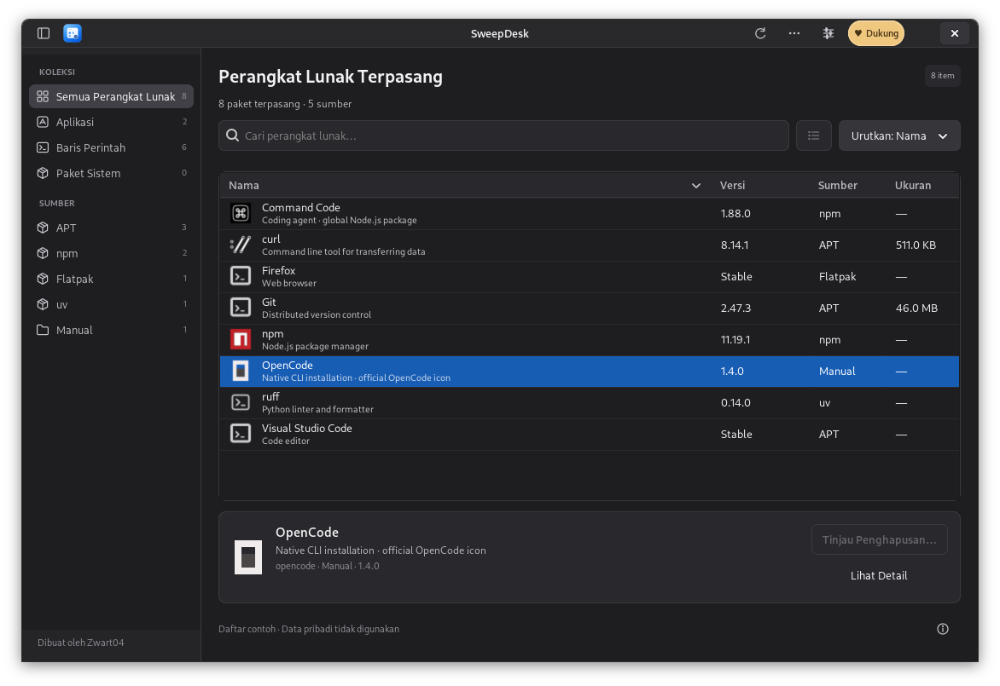
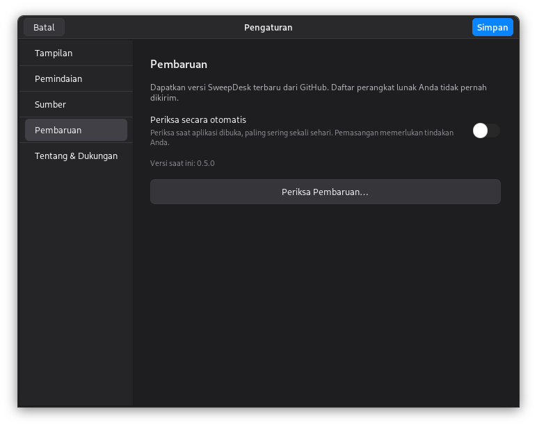
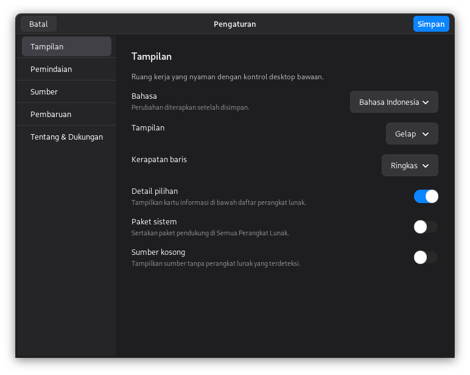

# SweepDesk

**[Website Bahasa Indonesia](https://zwart04.github.io/sweepdesk/id.html)** · [Unduh versi terbaru](https://github.com/Zwart04/sweepdesk/releases/latest) · [English](README.md)

Pengelola aplikasi GUI dan CLI untuk **Debian, Ubuntu, Fedora, openSUSE, Arch Linux, Alpine, dan distro turunan yang kompatibel**. Tema gelap memakai palet abu-abu netral dan aksen biru ala macOS.

[](https://tako.id/Zwart04)

**[Dukung pengembangan SweepDesk melalui Tako](https://tako.id/Zwart04)**. Dukungan bersifat sukarela; semua fitur tetap tersedia.



## Memasang dengan mudah

Pilih distro melalui **[halaman unduh](https://zwart04.github.io/sweepdesk/id.html#install)** atau [Releases](https://github.com/Zwart04/sweepdesk/releases/latest). `.deb` dipakai Ubuntu/Mint, bukan Fedora atau Arch.

| Distro | Berkas yang dipilih | Perintah dari folder unduhan |
|---|---|---|
| Debian / Ubuntu / Mint | `sweepdesk_0.5.0_all.deb` | `sudo apt install ./sweepdesk_0.5.0_all.deb` |
| Fedora / Rocky / AlmaLinux / keluarga RHEL | `sweepdesk-0.5.0-1.fedora.noarch.rpm` | `sudo dnf install ./sweepdesk-0.5.0-1.fedora.noarch.rpm` |
| openSUSE Leap / Tumbleweed | `sweepdesk-0.5.0-1.opensuse.noarch.rpm` | `sudo zypper install ./sweepdesk-0.5.0-1.opensuse.noarch.rpm` |
| Arch / EndeavourOS / Manjaro | `sweepdesk-0.5.0-1-any.pkg.tar.zst` | `sudo pacman -U ./sweepdesk-0.5.0-1-any.pkg.tar.zst` |
| Alpine / Linux lain dengan GTK 3 | `sweepdesk-0.5.0.tar.gz` | Ikuti bagian kode sumber di bawah |

Jika desktop menyediakan pemasang grafis yang sesuai, berkas paket juga dapat dibuka dengan klik dua kali. Tidak semua distro menyediakannya secara bawaan. Pengelola paket memasang komponen yang dibutuhkan. Paket RPM/Arch dari GitHub merupakan paket lokal tanpa tanda tangan; periksa checksum dan ikuti kebijakan/tanya jawab keamanan pengelola paket. SweepDesk tidak mematikan pemeriksaan keamanan secara global.

Buka **SweepDesk** dari menu aplikasi sebagai pengguna biasa. Kata sandi admin hanya diminta saat diperlukan. Untuk memperbarui secara manual, pasang paket versi baru dengan cara yang sama.

**Membangun paket Arch:** unduh `PKGBUILD` dari rilis yang sama ke folder kosong, pasang `base-devel` dan `git`, lalu jalankan `makepkg -si` sebagai pengguna biasa. Resep tersebut memeriksa SHA-256 arsip sumber. Ini bukan paket AUR dan tidak membutuhkan repositori pihak ketiga.

Untuk menghapus SweepDesk, gunakan pengelola distro: `sudo apt purge sweepdesk`, `sudo dnf remove sweepdesk`, `sudo zypper remove sweepdesk`, atau `sudo pacman -R sweepdesk`.

## Menjalankan dari kode sumber

Pasang komponen desktop sesuai distro:

```bash
# Debian / Ubuntu
sudo apt install python3 python3-gi gir1.2-gtk-3.0 librsvg2-common policykit-1
# Fedora / keluarga RHEL
sudo dnf install python3 python3-gobject gtk3 librsvg2 polkit
# openSUSE
sudo zypper install python3 python3-gobject gtk3 typelib-1_0-Gtk-3_0 librsvg-2-2 polkit
# Arch
sudo pacman -S python python-gobject gtk3 librsvg polkit
# Alpine desktop
sudo apk add python3 py3-gobject3 gtk+3.0 librsvg polkit
```

Ekstrak arsip portabel atau ambil kode sumber:

```bash
git clone https://github.com/Zwart04/sweepdesk.git
cd sweepdesk
./run.sh
```

Jika distro Debian tidak menyediakan `policykit-1`, gunakan `pkexec`. Jalankan dengan Python yang dapat membaca modul `gi` dan GTK 3. Untuk pintasan khusus pengguna, jalankan `./install.sh` tanpa sudo; hapus instalasi khusus pengguna dengan `./install.sh --uninstall`. Instalasi ini memakai interpreter Python saat pemasangan, sehingga tidak mengharuskan semua distro mempunyai `/usr/bin/python3`.

## Cakupan

Sumber yang didukung: **APT/DEB, RPM, Pacman, APK, npm global, pip, Cargo, Flatpak, Snap, pipx, uv tools, Bun global, Homebrew, AppImage ArtCraft, dan executable manual**. Manager yang belum terpasang tidak dipaksakan dipasang. Python sistem yang dilindungi PEP 668 tidak diubah paksa.

| Keluarga | Cakupan pengujian / kompatibilitas |
|---|---|
| Debian / Ubuntu | CI: Debian 11/12/13, Ubuntu 22.04/24.04/26.04 |
| Mint, LMDE, Pop!_OS, Zorin, elementary OS, Kali, Raspberry Pi OS | Diharapkan kompatibel dengan keluarga Debian/Ubuntu; belum diuji satu per satu |
| Fedora / RHEL | CI: Fedora terbaru dan Rocky 9. AlmaLinux, CentOS Stream, dan turunan lain memerlukan komponen yang sama |
| openSUSE | CI: Leap terbaru dan Tumbleweed terbaru |
| Arch | CI: Arch base. EndeavourOS, Manjaro, Garuda, CachyOS diharapkan kompatibel; belum diuji satu per satu |
| Alpine desktop | CI: Alpine terbaru, termasuk pemasangan khusus pengguna dan penghapusan APK |
| Linux lain | Antarmuka portabel dapat digunakan jika Python 3.9+, PyGObject, GTK 3.24+, librsvg, dan polkit tersedia. Penghapusan paket sistem belum tersedia untuk setiap pengelola |

Paket all/noarch/any tidak berisi biner SweepDesk khusus CPU. Komponen pendukung tetap harus tersedia untuk arsitektur Anda. CI memakai x86_64 dan bukan pengujian setiap versi desktop/arsitektur. Versi image terbaru/rolling dapat berubah; lihat [hasil Actions](https://github.com/Zwart04/sweepdesk/actions).

**Distro dengan sistem yang dikelola khusus** seperti Fedora Atomic/Silverblue, Bazzite, MicroOS, SteamOS, dan NixOS tetap memakai pembaruan sistem bawaannya. SweepDesk tidak memaksa menghapus atau mengganti paket dasar sistem tersebut. Paket sistem hanya ditampilkan jika basis datanya didukung. Windows dan macOS belum didukung.

## Bahasa aplikasi

Buka **Pengaturan → Tampilan → Bahasa**, pilih **Bahasa Indonesia**, **English**, atau **Ikuti sistem**, lalu tekan **Simpan**. Tampilan langsung berubah tanpa menutup aplikasi. Daftar, pencarian, dan Aktivitas sesi tetap tersedia. Pilihan bahasa nonaktif selama operasi masih berjalan.

**Ikuti sistem** membaca bahasa sesi desktop; jika bahasa tersebut belum didukung, aplikasi memakai English. Nama/ID paket, lokasi file, deskripsi dari pengelola paket, dan keluaran perintah eksternal tetap dalam bahasa aslinya. SweepDesk tidak mengirim data untuk diterjemahkan secara daring.

Website menyediakan tautan **Bahasa Indonesia / English** pada navigasi. Halaman Indonesia dapat dibuka langsung di **[zwart04.github.io/sweepdesk/id.html](https://zwart04.github.io/sweepdesk/id.html)**.

## Tombol pembaruan dari GitHub

SweepDesk memeriksa versi stabil terbaru saat dibuka dan selama tetap berjalan, paling sering sekali sehari. Jika tersedia, muncul tombol **Perbarui sekarang** dan nomor versinya di atas daftar perangkat lunak. Untuk memeriksa kapan saja, buka **Tindakan lainnya → Periksa Pembaruan** atau **Pengaturan → Pembaruan**. Pemeriksaan otomatis bisa dinonaktifkan.

Pada instalasi paket DEB/RPM/Arch, tombol tersebut menampilkan konfirmasi, mengunduh paket yang sesuai dari `Zwart04/sweepdesk`, lalu memeriksa ukuran dan SHA-256 terhadap `SHA256SUMS` serta digest GitHub jika tersedia. Pengelola paket distro memasangnya melalui autentikasi desktop. Setelah versi terpasang berhasil diperiksa, tersedia tombol **Buka ulang SweepDesk**. Jika pemasang atau kebijakan tanda tangan paket menolak, aplikasi melaporkan kegagalan.

**Menemukan pembaruan tidak langsung memasangnya.** Anda tetap menekan tombol pembaruan. Instalasi dari kode sumber/arsip portabel, Alpine dari sumber, dan sistem yang dikelola khusus membuka halaman rilis untuk pembaruan manual. Kode sumber yang sedang Anda edit tidak ditimpa. Daftar aplikasi dan log tidak dikirim; pemeriksaan hanya menghubungi API rilis publik GitHub tanpa token akun.



## Memakai aplikasi

1. Pilih kategori atau sumber instalasi pada **sidebar**. Cari nama aplikasi, ID paket, atau deskripsi. Deskripsi singkat tampil di bawah nama agar alasan kecocokan terlihat; misalnya kata `fire` juga cocok dengan **FireWire** pada deskripsi `libraw1394-11`. Deskripsi asli dari pengelola paket dipertahankan.
2. Gunakan **Paket Sistem** untuk melihat paket pendukung. Tombol **Opsi tampilan** mengatur visibilitas paket sistem, kerapatan baris, dan panel detail.
3. Klik dua kali untuk detail lengkap. **Klik kanan** menyediakan detail, daftar file APT, buka folder instalasi, salin ID/nama, dan pratinjau uninstall. Aksi yang tidak tersedia dibuat nonaktif.
4. Klik **Tinjau Penghapusan…**, pilih opsi pembersihan, lalu **Pratinjau Penghapusan**. Periksa daftar paket dan lokasi data sebelum mencentang persetujuan dan menekan **Hapus**.
5. Setelah proses selesai, panel hijau dengan tanda centang dan tulisan **Berhasil dihapus** menunjukkan keberhasilan. Jika ada langkah yang gagal, tampil panel **Penghapusan belum selesai** beserta log; sebagian perubahan mungkin telah berjalan.
6. **Tindakan lainnya (•••) → Aktivitas** menyimpan log operasi hanya untuk sesi berjalan. Menu ini juga menyediakan ekspor inventaris, status pemindaian, dan bantuan.

Tombol **Pengaturan** pada toolbar ringkas membuka pilihan bahasa, tema Gelap/Terang/Sistem, baris Ringkas/Longgar, panel detail, paket sistem, sumber pemindaian, dan folder tambahan. Pengaturan tersimpan di `~/.config/sweepdesk/preferences.json` atau lokasi `XDG_CONFIG_HOME`. Inventaris dan log operasi tidak disimpan otomatis.



Tambahkan virtualenv atau folder instalasi melalui **Pengaturan → Pemindaian** atau menu **Tindakan lainnya**. Folder bisa diingat untuk sesi berikutnya. Alternatif:

```bash
./run.sh --python "$HOME/proyek/demo/.venv/bin/python" --manual-dir "$HOME/Applications"
```

Pintasan: **Ctrl+F** mencari, **Ctrl+R** memindai ulang, **Ctrl+,** membuka Pengaturan, **Ctrl+I / Enter** membuka detail, **Ctrl+E** mengekspor, dan **Shift+F10** membuka menu klik kanan. **Delete** hanya memulai alur pratinjau, bukan langsung menghapus. Kontrol jendela tetap mengikuti desktop Linux.

Logo aplikasi tersedia sebagai SVG dan PNG 16–512 piksel serta dipasang melalui paket `.deb` agar dipakai di menu aplikasi dan integrasi jendela/dock. Tombol **♥ Dukung** berbentuk pill membuka [Tako Zwart04](https://tako.id/Zwart04).

## Seberapa bersih penghapusannya?

SweepDesk memakai uninstaller asli tiap manager dan hanya membersihkan data yang lokasinya dikenali. Dependensi bersama, cache bersama, snapshot Snap, runtime Flatpak, dan paket orphan lama yang tidak terkait tidak dihapus sembarangan. Rinciannya:

| Sumber | Yang dapat dihapus dan batasannya |
|---|---|
| **APT / DEB** | Menghapus paket dan konfigurasi milik paket melalui purge. Pratinjau memeriksa dampak dependensi. Opsi paket pendukung hanya mencakup yang tidak lagi dibutuhkan setelah aplikasi ini dihapus; paket lain yang sudah tidak terpakai sebelumnya tetap disimpan. |
| **RPM (Fedora/openSUSE)** | Hanya menghapus paket pilihan dengan pemeriksaan dependensi RPM tetap aktif. Jika masih dibutuhkan paket lain, penghapusan ditolak. Paket pendukung dan cadangan pengaturan `.rpmsave` disimpan. Riwayat transaksi DNF/Zypper tidak diperbarui oleh penghapusan RPM langsung. |
| **Pacman (Arch)** | Memakai pratinjau bawaan yang diperiksa kembali. Opsi paket pendukung memakai `-Rs`, tanpa penghapusan berantai atau pemaksaan dependensi. Pengaturan yang berubah dapat tersimpan sebagai `.pacsave`. Paket AUR yang terpasang lewat Pacman ikut terlihat. |
| **APK (Alpine)** | Memakai simulasi penghapusan yang diperiksa kembali. Paket pendukung yang baru tidak diperlukan dapat ikut dihapus sesuai daftar. Tidak memaksa menghapus aplikasi lain atau pengaturan yang diubah. |
| **npm global** | Memakai prefix global yang terdeteksi secara tepat. Pohon paket dikelola npm; skrip siklus hidup dinonaktifkan. Prefix sistem di luar beranda hanya ditampilkan. |
| **pip** | Memakai interpreter dan catatan RECORD lingkungan yang dipilih. Dependensi bersama, paket yang diminta secara eksplisit, alat pengelola, dan metadata yang belum pasti dipertahankan. Python sistem yang dilindungi PEP 668 tidak diubah paksa. |
| **Cargo** | Memakai cargo uninstall. Cache registri, unduhan sumber, dan cache kompilasi bersama dipertahankan. |
| **Flatpak** | Menghapus aplikasi dari instalasi pengguna atau sistem. Data aplikasi yang dipilih dipindahkan ke Sampah; runtime bersama/tidak terpakai tidak dibersihkan global. |
| **Snap** | Memakai penghapusan bawaan Snap. Kebijakan snapshot normal tetap berlaku; snapshot tidak dipurge paksa. |
| **pipx / uv tools** | Memakai uninstaller masing-masing untuk lingkungan alat dan program yang dikelolanya. |
| **Bun global** | Memakai penghapusan global dan hubungan dependensi Bun. Cache bersama dipertahankan. |
| **Homebrew** | Memakai brew uninstall dengan perlindungan formula yang masih dibutuhkan. Tidak mengabaikan dependensi atau membersihkan cache global. |
| **ArtCraft AppImage** | File executable, ikon, dan pintasan yang tercatat dipindahkan ke Sampah; catatan diperbarui setelah berhasil. Tutup ArtCraft Launcher dahulu. |
| **Manual / skrip / curl** | Program/lokasi instalasi pengguna yang dikenali dapat dipindahkan ke Sampah. File sistem tanpa registrasi hanya ditampilkan. Perubahan PATH, layanan, dan file sembarang dari skrip mungkin tidak terdeteksi. |


**Tidak ada jaminan semua sisa setiap installer bisa diketahui.** Skrip `curl | bash` dapat menulis ke sembarang tempat tanpa daftar kepemilikan. SweepDesk mendeteksi executable/lokasi yang dikenal; file sistem tanpa registrasi hanya dapat diinventarisasi. File proyek dan seluruh virtualenv di disk tidak dipindai otomatis.

Profil data yang saat ini dikenali meliputi LibreOffice, OpenCode, Claude Code, Codex, curl, dan data aplikasi Flatpak. Pembersihan data bersifat pilihan dan dapat mencakup riwayat, login, profil, serta pengaturan. Data dipindahkan ke **Sampah**, sehingga ruang baru kembali setelah Sampah dikosongkan. Bila Sampah tidak tersedia, penghapusan tidak dialihkan ke hapus permanen.

Ikon aplikasi dibaca dari launcher lokal. Logo resmi OpenCode, Command Code, curl, dan npm disertakan agar CLI tertentu juga mudah dikenali tanpa internet. CLI lain memakai ikon terminal bila ikon resminya belum tersedia.

## Jika terjadi masalah

- **Sumber tidak terlihat:** pastikan pengelolanya terpasang dan aktif di **Pengaturan → Sumber**, lalu pindai ulang.
- **Lingkungan Python/folder manual tidak terlihat:** tambahkan lokasinya melalui **Pengaturan → Pemindaian**.
- **Tidak ada dialog kata sandi:** jalankan aplikasi sebagai pengguna biasa dalam sesi desktop yang memiliki agen polkit.
- **Penghapusan belum selesai:** baca log di **Aktivitas**. Jangan langsung mengulang tanpa memeriksa status pengelola paket; sebagian langkah mungkin sudah berjalan.
- **Berhasil dihapus tetapi data masih ada:** pembersihan data harus dipilih, hanya lokasi yang dikenali yang diproses, dan data di Sampah masih memakai ruang sampai dikosongkan sendiri.

## Pengembangan dan pemeriksaan

```bash
python3 -m unittest discover -s tests -v
python3 scripts/build.py
```

Hasil paket berada di `dist/`, termasuk `.deb`, arsip sumber, dan `SHA256SUMS`. Jalankan `sha256sum -c SHA256SUMS` pada folder unduhan untuk memeriksa berkas. CI menguji backend, UI, bahasa, pencarian, hasil penghapusan, pemeriksaan/checksum pembaruan, serta paket asli di container distro. Pengujian memasang dan menghapus paket contoh `tree` hanya dalam container yang dapat dibuang. Penghapusan pip memakai lingkungan virtual terisolasi. Pengujian tidak menghapus aplikasi di komputer pengguna.

## Bantuan dan dukungan

- [Dokumentasi lengkap berbahasa Inggris](README.md)
- [Laporkan masalah](https://github.com/Zwart04/sweepdesk/issues)
- **[♥ Dukung Zwart04 melalui Tako](https://tako.id/Zwart04)** — tombol yang sama ada pada judul aplikasi.

Jangan unggah inventaris pribadi, token, atau kata sandi ke laporan publik. Kode asli berlisensi MIT; merek dan logo tetap milik pembuatnya.
