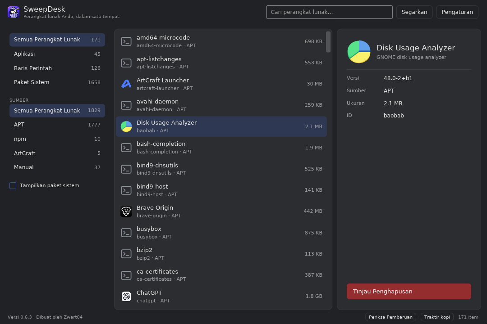
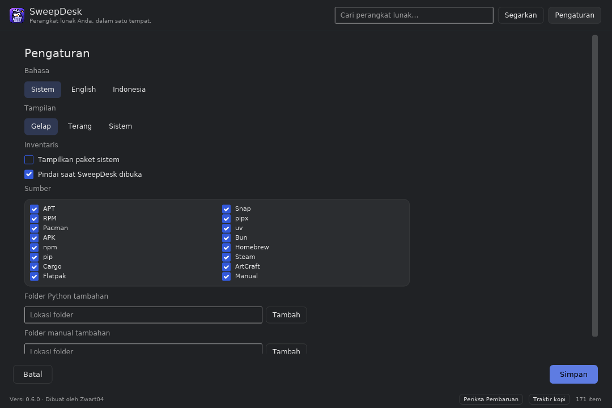

# SweepDesk


**[Website Bahasa Indonesia](https://zwart04.github.io/sweepdesk/id.html)** · [Unduh versi terbaru](https://github.com/Zwart04/sweepdesk/releases/latest) · [English](README.md)

Pengelola aplikasi GUI dan CLI untuk **Debian, Ubuntu, Fedora, openSUSE, Arch Linux, Alpine, dan distro turunan yang kompatibel**. Satu biner Rust yang hanya bergantung pada glibc, jadi tidak perlu Python, GTK, atau runtime tambahan.

[](https://tako.id/Zwart04)

**[Traktir kopi untuk pengembang SweepDesk](https://tako.id/Zwart04)**. Traktiran bersifat sukarela; semua fitur tetap tersedia.



## Memasang dengan mudah

SweepDesk membutuhkan **glibc 2.28 atau lebih baru** dan sesi desktop Linux. `pkexec` (polkit) hanya dipakai saat menghapus paket sistem. Pilih distro melalui **[halaman unduh](https://zwart04.github.io/sweepdesk/id.html#install)** atau [Releases](https://github.com/Zwart04/sweepdesk/releases/latest). `.deb` dipakai Ubuntu/Mint, bukan Fedora atau Arch.

| Distro | Berkas yang dipilih | Perintah dari folder unduhan |
|---|---|---|
| Debian / Ubuntu / Mint | `sweepdesk_0.6.4_amd64.deb` | `sudo apt install ./sweepdesk_0.6.4_amd64.deb` |
| Fedora / Rocky / AlmaLinux / keluarga RHEL | `sweepdesk-0.6.4-1.fedora.x86_64.rpm` | `sudo dnf install ./sweepdesk-0.6.4-1.fedora.x86_64.rpm` |
| openSUSE Leap / Tumbleweed | `sweepdesk-0.6.4-1.opensuse.x86_64.rpm` | `sudo zypper install ./sweepdesk-0.6.4-1.opensuse.x86_64.rpm` |
| Arch / EndeavourOS / Manjaro | `sweepdesk-0.6.4-1-x86_64.pkg.tar.zst` | `sudo pacman -U ./sweepdesk-0.6.4-1-x86_64.pkg.tar.zst` |
| Distro Linux lain / immutable | `sweepdesk-0.6.4-x86_64.tar.gz` | Jalankan `./sweepdesk` dari folder hasil ekstrak |

Paket RPM/Arch dari GitHub merupakan paket lokal tanpa tanda tangan; periksa checksum SHA-256 bila kebijakan Anda memintanya. SweepDesk tidak mematikan pemeriksaan tanda tangan atau dependensi. Buka **SweepDesk** dari menu aplikasi sebagai pengguna biasa; kata sandi admin hanya diminta saat menghapus paket sistem.

Untuk menghapus SweepDesk, gunakan pengelola distro: `sudo apt purge sweepdesk`, `sudo dnf remove sweepdesk`, `sudo zypper remove sweepdesk`, atau `sudo pacman -R sweepdesk`.

## Menjalankan dari arsip portabel atau kode sumber

```bash
tar xzf sweepdesk-0.6.4-x86_64.tar.gz
cd sweepdesk-0.6.4
./sweepdesk
```

Atau bangun sendiri (butuh Rust 1.80 atau lebih baru):

```bash
git clone https://github.com/Zwart04/sweepdesk.git
cd sweepdesk
./install.sh      # membangun dengan cargo, memasang ke ~/.local
```

`./install.py --uninstall` menghapus instalasi khusus pengguna dan membiarkan folder sumber. SweepDesk tidak memakai layanan latar belakang, telemetri, atau server web; daftar aplikasi dan log operasi tidak pernah dikirim ke mana pun.

## Cakupan pembersihan

Pilih aplikasi, tekan **Tinjau Penghapusan**, lalu baca rencananya. Tombol konfirmasi baru aktif setelah kotak persetujuan dicentang, dan SweepDesk selalu memeriksa ulang keadaan paket atau berkas sebelum bertindak.

| Sumber | Inventaris | Penghapusan |
|---|---|---|
| **APT / dpkg** | Basis data `dpkg-query` | `apt-get purge` lewat polkit setelah simulasi dibandingkan ulang |
| **RPM** | `rpm -qa` | `pkexec rpm -e` |
| **Pacman** | `/var/lib/pacman/local` | `pkexec pacman -Rns`, dependensi ditampilkan lebih dulu |
| **APK** | `/lib/apk/db/installed` | `pkexec apk del` |
| **Flatpak** | Daftar aplikasi user dan sistem | `flatpak uninstall` untuk aplikasi itu saja |
| **npm** | Prefix global di PATH, nvm, fnm | `npm uninstall -g --ignore-scripts` di dalam home Anda |
| **pip** | Metadata `*.dist-info` dibaca langsung; sistem, venv, Conda, pyenv, folder tambahan | `pip uninstall` milik interpreter, hanya untuk lingkungan milik pengguna |
| **pipx / uv tools** | Daftar tool masing-masing | Perintah uninstall milik tool tersebut |
| **Cargo** | `cargo install --list` | `cargo uninstall` |
| **Snap** | `snap list` | `pkexec snap remove` tanpa `--purge` |
| **Bun** | Manifest paket global | `bun remove --global --ignore-scripts` |
| **Homebrew** | `brew info --json=v2 --installed` | `brew uninstall --formula` |
| **Steam** | Manifest game dan folder library | Folder game beserta manifest dipindahkan ke Trash; folder tanpa manifest ditampilkan terpisah |
| **ArtCraft** | Registry launcher dan pintasan AppImage pengguna | Berkas dipindahkan ke Trash, entri registry ditulis ulang |
| **Manual** | Executable di `~/.local/bin`, `~/bin`, `~/.opencode/bin`, `/usr/local/bin`, folder tambahan; launcher Horizon yang terverifikasi | Hanya berkas milik pengguna yang dipindahkan ke Trash |

### Aturan keamanan

- Berkas paket tidak pernah dihapus manual; pengelola paket pemiliknya yang menghapus.
- Data pengguna dan berkas tanpa pemilik hanya **dipindahkan ke Trash**, tidak pernah dihapus permanen.
- Path harus milik pengguna, tanpa symlink induk, dan bukan direktori sistem. Direktori luas seperti `$HOME` ditolak.
- Berkas game Steam diberi sidik jari saat rencana dibuat dan dibandingkan lagi saat eksekusi; penghapusan ditolak bila Steam atau game sedang berjalan.
- Launcher Horizon hanya dihapus setelah biner, pintasan, dan ikonnya terbukti milik Horizon; akun yang tersimpan dikeluarkan lebih dulu.
- Item yang tidak bisa dihapus tetap tampil beserta alasannya. Paket inti, pustaka bersama, dan lokasi sistem hanya untuk inventaris.
- Pilihan **Ikut pindahkan data pengguna ke Trash** bersifat opsional per penghapusan. Profil LibreOffice, OpenCode, Claude Code, Codex, curl, aplikasi Flatpak, game Steam, dan launcher Horizon dikenali.
- Cache dan runtime bersama dipertahankan. Flatpak menentukan ekstensi terkait saat eksekusi; tidak ada pembersihan runtime global.

## Menggunakan SweepDesk

- **Sidebar:** filter kategori (semua perangkat lunak, aplikasi, baris perintah, paket sistem) dan sumber dengan jumlah langsung.
- **Pencarian:** mencocokkan nama, ID paket, sumber, dan deskripsi.
- **Detail:** versi, sumber, ukuran, ID paket, cakupan, serta alasan bila penghapusan tidak tersedia.
- **Rencana penghapusan:** menampilkan perintah, paket, berkas, dan folder data pengguna sebelum apa pun dijalankan.



### Pengaturan

- **Bahasa:** Indonesia, English, atau mengikuti locale sistem. Perubahan berlaku langsung setelah **Simpan**.
- **Tampilan:** tema gelap, terang, atau mengikuti sistem.
- **Inventaris:** tampilkan paket sistem, pindai saat SweepDesk dibuka, aktifkan/nonaktifkan sumber, serta tambah folder Python atau folder manual.

Preferensi disimpan di `$XDG_CONFIG_HOME/sweepdesk/preferences.json` (biasanya `~/.config/sweepdesk/preferences.json`) dengan izin khusus pemilik. Inventaris tidak pernah ditulis ke disk.

### Pembaruan

**Periksa Pembaruan** menanyakan rilis terbaru ke GitHub, mengunduh paket yang sesuai distro Anda, memverifikasinya terhadap `SHA256SUMS` resmi, lalu memasangnya dengan pengelola paket distro melalui `pkexec`. Tidak ada yang diunduh atau dipasang sebelum Anda menekan **Pasang pembaruan**, dan permintaan kata sandi sama seperti perubahan paket biasa. Jika paket untuk distro Anda tidak tersedia, SweepDesk membuka halaman rilis.

## Jika ada masalah

- **Tidak ada permintaan kata sandi:** gunakan sesi desktop normal dengan agen polkit, dan jangan jalankan seluruh aplikasi sebagai root.
- **Sumber tidak muncul:** pasang atau aktifkan pengelolanya, pastikan tersedia di `PATH`, lalu tekan Refresh. Lokasi nvm/fnm npm, Cargo standar, Bun, uv, dan Linuxbrew juga diperiksa.
- **Paket Python tidak muncul:** tambahkan folder lingkungannya di **Pengaturan → Folder Python tambahan**. Paket dpkg biasanya muncul di APT, bukan dua kali di pip.
- **Instalasi manual tidak muncul:** tambahkan foldernya di **Pengaturan → Folder manual tambahan**. Hanya executable langsung di dalam folder itu yang dipindai.
- **Item tidak bisa dihapus:** baca panel detailnya. Kepemilikan sistem, proteksi PEP 668, `RECORD` yang hilang, atau instalasi yang tidak bisa diverifikasi semuanya mencegah penghapusan aman.
- **Operasi gagal:** simpan pesan galat, sumber, nama paket, dan distro. Laporkan melalui [Issues](https://github.com/Zwart04/sweepdesk/issues). Jangan memposting token atau daftar aplikasi pribadi.

## Pengembangan dan pengujian

```bash
cargo test --manifest-path rust/Cargo.toml
cargo build --release --manifest-path rust/Cargo.toml
python3 scripts/build.py            # arsip portabel + .deb
python3 scripts/build.py --format rpm --rpm-flavor fedora
python3 scripts/build.py --format rpm --rpm-flavor opensuse
python3 scripts/build.py --format arch
```

Hasil build ditulis ke `dist/`: arsip portabel, paket native, dan `SHA256SUMS`. Build RPM membutuhkan `rpmbuild`; build Arch membutuhkan `makepkg` dan pengguna non-root. Verifikasi dengan `sha256sum -c SHA256SUMS` di folder tersebut.

Uji Rust mencakup katalog bahasa, migrasi preferensi, keamanan path, penyaringan manifest Steam, serta inventaris ArtCraft/launcher memakai fixture sementara. CI membangun dan memasang paket nyata pada setiap keluarga yang terdaftar, lalu menjalankan `sweepdesk --scan` sebagai pengguna biasa di dalam kontainer sekali pakai. Pengujian tidak pernah menyentuh aplikasi terpasang di host. Tangkapan layar README memakai daftar contoh berlabel, bukan daftar perangkat lunak pribadi.

## Traktir kopi

**[Traktir kopi → tako.id/Zwart04](https://tako.id/Zwart04)** membantu pemeliharaan kompatibilitas, pengujian, dan profil pembersihan baru. Traktiran bersifat sukarela; semua fitur tetap tersedia.

Kode asli, karya ikon, dan dokumentasi: [GNU GPL v3.0 atau lebih baru](LICENSE) (`GPL-3.0-or-later`), hak cipta (C) 2026 Zwart04. Tanpa jaminan. Redistribusi versi modifikasi wajib mematuhi GPL, termasuk menyediakan kode sumber. Rilis sampai 0.5.1 tetap memakai izin MIT; lihat [riwayat lisensi](docs/LICENSE-HISTORY.md). Nama dan karya pihak ketiga tetap mengikuti ketentuan masing-masing. SweepDesk tidak berafiliasi dengan Debian, Ubuntu, ArtCraft, atau pengelola paket yang didukungnya.
