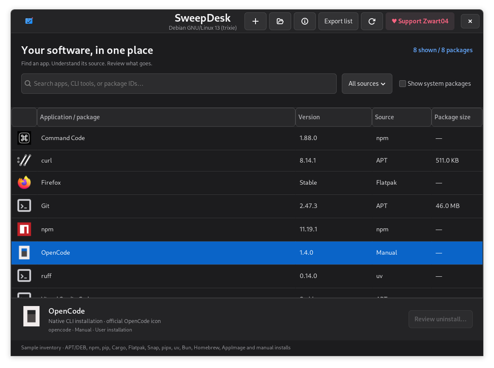

<div align="center">
  
  <h1>SweepDesk</h1>
  <p><strong>Your software, in one place.</strong><br>A native software inventory and uninstall app for Debian, Ubuntu, and compatible derivatives.</p>
  <p>
    <a href="https://github.com/Zwart04/sweepdesk/releases/latest">Download</a> ·
    <a href="#installation">Installation</a> ·
    <a href="#what-can-it-clean">Cleanup coverage</a> ·
    <a href="README.id.md">Bahasa Indonesia</a>
  </p>
  <a href="https://tako.id/Zwart04"></a>
  <p>Free and open source. If SweepDesk helps you, support its development on <a href="https://tako.id/Zwart04"><strong>Tako</strong></a>.</p>
</div>



SweepDesk brings graphical apps and command-line tools into a familiar program list. Search by name or package ID, filter by installation source, inspect the uninstall plan, and choose whether to clean known user data. The dark interface uses neutral charcoal panels and a blue accent. A visible **♥ Support Zwart04** button opens the project's Tako page.

## Compatibility

SweepDesk is **not limited to Debian**. It targets Debian-family graphical Linux desktops with **Python 3.9+, GTK 3.24+, APT/dpkg, and a desktop authentication agent**.

| System | Status |
|---|---|
| Debian 11, 12, 13 | Targeted; CI covers these base images |
| Ubuntu 22.04, 24.04, 26.04 | Targeted; CI covers these base images |
| Linux Mint, LMDE, Pop!_OS, elementary OS, Zorin OS, Kali and other Debian/Ubuntu derivatives | Expected to work when the requirements above are available; not each independently tested |
| Older versions with Python below 3.9, Ubuntu Core, headless servers | Not supported as a normal desktop install |
| Windows, macOS, non-Debian package managers such as RPM/Pacman | Not supported by this release |

The `.deb` is architecture-independent Python code: usable on amd64, arm64, and other architectures supported by the required distribution packages. CI status is visible in [Actions](https://github.com/Zwart04/sweepdesk/actions); an untested system is not a guarantee of compatibility.

## Installation

### Recommended: install the Debian package

1. Open [Releases](https://github.com/Zwart04/sweepdesk/releases/latest).
2. Download `sweepdesk_0.2.0_all.deb`.
3. Double-click it in your software installer, or open a terminal in the download folder and run:

```bash
sudo apt install ./sweepdesk_0.2.0_all.deb
```

APT installs the required Python, GTK, SVG, and authentication dependencies. Open **SweepDesk** from your application menu, or run `sweepdesk`. **Run the app as your normal user**, not with sudo; administrator authentication is requested when a system-package operation needs it.

To update, install the newer `.deb` the same way. To uninstall SweepDesk itself:

```bash
sudo apt purge sweepdesk
```

### Run from source or the portable archive

Install desktop dependencies once:

```bash
sudo apt install python3 python3-gi gir1.2-gtk-3.0 librsvg2-common policykit-1
```

Some newer distributions provide `pkexec` as its own package; if `policykit-1` has no candidate, install `pkexec` instead. Use your distribution's desktop polkit agent for password dialogs.

Download and extract `sweepdesk-0.2.0.tar.gz` from Releases, or clone the repository:

```bash
git clone https://github.com/Zwart04/sweepdesk.git
cd sweepdesk
./run.sh
```

No PyPI dependencies, background service, telemetry, or web server are required. The application does not download icons while scanning.

### Optional: add a per-user launcher

From the source/archive folder:

```bash
./install.sh
```

This copies the app to `~/.local/share/sweepdesk`, adds `~/.local/bin/sweepdesk`, and creates a menu entry. It respects `XDG_DATA_HOME`; `--prefix` allows a custom user-owned prefix. Do not use sudo for this installer.

```bash
./install.sh --uninstall
```

The per-user uninstaller removes only the managed SweepDesk installation. It keeps the downloaded source folder and other applications.

## Using SweepDesk

1. Wait for the local scan to finish. Only available package managers are queried.
2. Search for an app or CLI, for example `curl`, `command-code`, `opencode`, or `libreoffice`.
3. Use the source filter, including **Manual**, to narrow the list. Enable **Show system packages** to see the full APT inventory; search also includes normally hidden support packages.
4. Select an item and click **Review uninstall…**. Optional dependency and user-data cleanup starts unchecked.
5. Review the packages, exact known paths, notes, and commands. Acknowledge the list and click **Uninstall now**.
6. Read the operation log. Failed authentication or a package-manager error is reported; user data is not cleaned after a failed uninstall command.

The **folder button** adds a Python virtual environment. The **+ button** scans a custom installation folder for executables directly inside it. Added folders apply to the current session. You can also pass them on the command line:

```bash
./run.sh --python "$HOME/projects/demo/.venv/bin/python" \
         --manual-dir "$HOME/Applications"
./run.sh --scan-json > software-inventory.json
```

The export can contain usernames, install paths, and package names. Save or share it deliberately; it is not uploaded by the app.

## What can it clean?

| Source | Inventory and removal | Dependency/data behavior |
|---|---|---|
| **APT / DEB** | Installed dpkg packages, including CLI tools and local `.deb` installs | Purges package-managed configuration; previews dependency changes; optionally includes only dependencies newly made unused by this removal |
| **npm global** | Active npm and standard nvm/fnm locations | Uses the exact global prefix; npm removes its package tree; lifecycle scripts disabled; system-owned prefixes are inventory-only |
| **pip** | Current/system Python, active virtualenv/Conda prefix, pyenv installations, and explicitly added environments | Uses the selected interpreter and RECORD metadata; optional conservative orphan dependency calculation; preserves explicitly requested/shared packages and packaging tools |
| **Cargo** | `cargo install` applications | Uses `cargo uninstall`; shared registries, source downloads, and build caches stay |
| **Flatpak** | Apps in default per-user and system installations | Uses Flatpak uninstall; optional application data in `~/.var/app/APP_ID` goes to Trash; shared and unused runtimes are retained |
| **Snap** | Installed snaps | Uses Snap removal; Snap's normal snapshot policy applies; snapshots are not force-purged |
| **pipx / uv tools** | Isolated user-installed Python tools | Uses their own uninstaller for the tool environment and managed executables |
| **Bun global** | The configured global installation | Uses Bun's global removal and dependency graph; shared cache retained |
| **Homebrew** | Installed Linux formulae | Uses Homebrew uninstall; dependent formulae remain protected; unrelated orphan/cache cleanup is disabled |
| **ArtCraft AppImages** | AppImages recorded by ArtCraft Launcher | Moves recorded executable/icon/shortcut files to Trash and updates the launcher record after success; close ArtCraft Launcher first |
| **Manual / script / curl installs** | Standard user bin locations, `/usr/local/bin`, user AppImage launchers, known OpenCode/Claude native locations, and custom folders you add | Known user-owned executable paths or install trees can go to Trash; system-wide unregistered files are inventory-only |

### “Clean” does not mean guessing every file

`curl` is a download tool, not an installation database. A `curl … | bash` script can write arbitrary files, edit shell configuration, create users or services, and install other tools. **No generic scan can reliably attribute all such changes to one application.** SweepDesk shows what it knows instead of claiming that every installer can be cleaned completely.

Known user-data profiles currently include **LibreOffice, OpenCode, Claude Code, Codex, curl**, and **Flatpak app data**. Other applications may leave configuration or cache files. Settings inside projects, arbitrary venvs, containers, and unexplored drives are not searched automatically.

User-data cleanup is **opt-in**. Known folders can include sign-ins, history, profiles, custom instructions, and settings. They go to your desktop **Trash**, not a recursive permanent-delete command. Empty Trash yourself when you are satisfied; until then, that data still uses disk space. If Trash is unavailable, SweepDesk reports an error instead of silently deleting permanently.

Shared dependency caches are retained. APT core packages and common desktop components are blocked from removal. LibreOffice's shared profile can only be cleaned when removing the entire suite. pip **does not bypass PEP 668** or automatically modify a system-managed Python. Legacy pip installs without RECORD metadata are not automatically removable. pip dependency metadata may be incomplete; uncertain or shared dependencies are kept.

APT plans and pip environments are checked again before execution. Close other package managers during removal. A package-manager failure can leave a partially completed transaction; review the log and repair it with the owning manager. These protections reduce risk; they do not replace package-manager guarantees or a backup.

## Icons

SweepDesk prefers icons from the installed app's launcher/theme. Official **OpenCode, Command Code, curl, and npm** brand assets are bundled for supported CLI identities and work offline. Tools without an available official icon use a terminal/package symbol. See [third-party notices](THIRD_PARTY_NOTICES.md) and the [asset source manifest](assets/brands/sources.json).

## Troubleshooting

- **Missing `gi` or GTK:** install the distribution dependencies above and use `/usr/bin/python3`, not a project virtualenv for the GUI.
- **No password prompt:** use a normal desktop session with a polkit authentication agent. Do not run the whole app as root.
- **A source is absent:** install/enable its manager, ensure it is reachable on PATH, then refresh. nvm/fnm npm, standard Cargo, Bun, uv, and Linuxbrew locations are also checked.
- **A Python package is absent:** add the environment's folder with the folder button or `--python`. System dpkg packages normally appear under APT, not twice under pip.
- **A manual install is absent:** add its installation folder with **+** or `--manual-dir`. Only direct executable children are scanned; source directories are not recursively deleted.
- **Pip item is read-only:** read its detail panel. PEP 668, system ownership, missing pip, or missing RECORD can prevent safe removal.
- **An operation fails:** preserve the visible error, source, package name and distro information. Report it in [Issues](https://github.com/Zwart04/sweepdesk/issues). Avoid posting tokens or a private inventory publicly.

## Development and tests

```bash
python3 -m unittest discover -s tests -v
python3 scripts/build.py
```

Build output is written to `dist/`: a portable archive, an `Architecture: all` `.deb`, and `SHA256SUMS`. SHA-256 checksums can be checked with `sha256sum -c SHA256SUMS` from that folder. The package uses distro Python/GTK rather than bundling a foreign runtime.

CI runs unit/UI checks under Xvfb on the listed Debian and Ubuntu images. Package-manager fixtures cover unavailable optional sources. Real-world testing of every manager, distro derivative, and privileged removal is not implied. Tests never remove the host's installed applications. The README screenshot uses a labeled sample inventory, not a user's private software list.

## Support the project

<a href="https://tako.id/Zwart04"></a>

**[Support Zwart04 → tako.id/Zwart04](https://tako.id/Zwart04)** helps maintain compatibility, testing, and new cleanup profiles. Support is optional; all features remain available. The same support button is always available in SweepDesk's title bar.

Original code: [MIT License](LICENSE). Third-party names and artwork remain under their upstream terms. SweepDesk is independent of Debian, Ubuntu, ArtCraft, and the package managers it supports.
