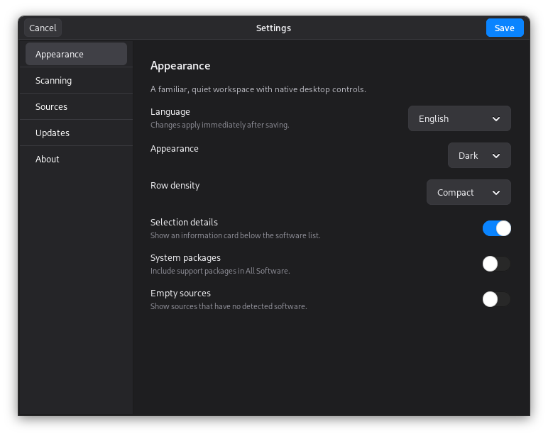
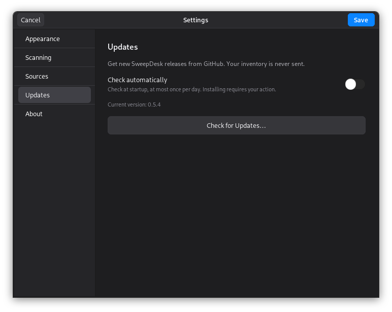

<div align="center">
  
  <h1>SweepDesk</h1>
  <p><strong>Your software, in one place.</strong><br>A native software inventory and uninstall app for major Linux desktop families.</p>
  <p>
    <a href="https://zwart04.github.io/sweepdesk/">Website</a> ·
    <a href="https://github.com/Zwart04/sweepdesk/releases/latest">Download</a> ·
    <a href="#installation">Installation</a> ·
    <a href="#what-can-it-clean">Cleanup coverage</a> ·
    <a href="README.id.md">Bahasa Indonesia</a>
  </p>
  <a href="https://tako.id/Zwart04"></a>
  <p>Free and open source. If SweepDesk helps you, buy me a coffee on <a href="https://tako.id/Zwart04"><strong>Tako</strong></a>.</p>
</div>


SweepDesk brings graphical apps and command-line tools into a familiar program list. Search by name, package ID, or description, filter by installation source, inspect the uninstall plan, and choose whether to clean known user data. The dark interface uses neutral charcoal panels and a blue accent. A visible **Buy me a coffee** pill opens the project's Tako page.

## Compatibility

SweepDesk requires **Python 3.9+, PyGObject, GTK 3.24+, librsvg, and polkit** in a graphical Linux session. Package formats are distribution-specific; a `.deb` is for Debian-family systems, not Fedora or Arch.

| Family | Download | System package support | Coverage |
|---|---|---|---|
| Debian, Ubuntu | `.deb` | APT / DEB | CI: Debian 11/12/13 and Ubuntu 22.04/24.04/26.04 |
| Linux Mint, LMDE, Pop!_OS, Zorin, elementary OS, Kali, Raspberry Pi OS | `.deb` | APT / DEB | Compatible derivatives; not individually tested |
| Fedora, RHEL-compatible, Rocky, AlmaLinux, CentOS Stream | Fedora `.rpm` | RPM | CI: Fedora latest and Rocky 9; other derivatives require the listed dependencies |
| openSUSE Leap / Tumbleweed | openSUSE `.rpm` | RPM | CI: Leap latest and Tumbleweed latest |
| Arch Linux, EndeavourOS, Manjaro, Garuda, CachyOS | `.pkg.tar.zst` or `PKGBUILD` | Pacman / ALPM | CI: Arch base; derivatives are not individually tested |
| Alpine Linux desktop | Portable source + dependencies | APK | CI: Alpine latest, including per-user installation |
| Other Linux desktops | Portable source | Available non-system sources | Requires the runtime above; native system-package removal is not implemented for every manager |
| Immutable/transactional desktops: Fedora Atomic, Bazzite, MicroOS, SteamOS, NixOS | Distribution-managed/source setup | Protected system inventory where a supported database exists | Base-system removal and in-app system installation are blocked; use the distribution updater |
| Windows / macOS | — | — | Unsupported |

Packages are Python **all/noarch/any**, with no CPU-specific SweepDesk binary. The required runtime packages must exist for your architecture. CI containers run on x86_64; other CPU architectures and full desktop sessions are not all independently tested. See [Actions](https://github.com/Zwart04/sweepdesk/actions) for actual base images and results. Rolling/latest image versions can change between runs.

## Installation

### Install the package for your distribution

Open [the download selector](https://zwart04.github.io/sweepdesk/#install) or [Releases](https://github.com/Zwart04/sweepdesk/releases/latest), download the correct file, then run from its folder:

```bash
# Debian / Ubuntu / Linux Mint
sudo apt install ./sweepdesk_0.5.4_all.deb

# Fedora / Rocky / AlmaLinux / RHEL-compatible
sudo dnf install ./sweepdesk-0.5.4-1.fedora.noarch.rpm

# openSUSE Leap / Tumbleweed
sudo zypper install ./sweepdesk-0.5.4-1.opensuse.noarch.rpm

# Arch / EndeavourOS / Manjaro
sudo pacman -U ./sweepdesk-0.5.4-1-any.pkg.tar.zst
```

A graphical package installer can open these files when the desktop provides one; a double-click installer is not guaranteed on every distribution. Native managers install the declared runtime dependencies. GitHub RPM/Arch artifacts are unsigned local packages; inspect native signature prompts/policies and verify the published SHA-256 checksums. SweepDesk does not globally disable signature or dependency checks.

Open **SweepDesk** from the application menu, or run `sweepdesk`. Run it as your normal user. Administrator authentication is requested only for system operations. Install a newer package the same way to update.

To uninstall SweepDesk itself, use your native manager: `sudo apt purge sweepdesk`, `sudo dnf remove sweepdesk`, `sudo zypper remove sweepdesk`, or `sudo pacman -R sweepdesk`.

### Build on Arch with PKGBUILD

Download the release's `PKGBUILD`, place it in an empty folder, install Arch's `base-devel` and `git` build tools, then run **as a normal user**:

```bash
makepkg -si
```

The release recipe pins the portable source archive's SHA-256. It is a download/build recipe, not an AUR submission; no AUR package or third-party repository is required. Do not use a `PKGBUILD` from a different release with a renamed source archive.

### Run from source or the portable archive

Install the desktop dependencies with your distribution's manager:

```bash
# Debian / Ubuntu
sudo apt install python3 python3-gi gir1.2-gtk-3.0 librsvg2-common policykit-1
# Fedora / RHEL-compatible
sudo dnf install python3 python3-gobject gtk3 librsvg2 polkit
# openSUSE
sudo zypper install python3 python3-gobject gtk3 typelib-1_0-Gtk-3_0 librsvg-2-2 polkit
# Arch
sudo pacman -S python python-gobject gtk3 librsvg polkit
# Alpine desktop
sudo apk add python3 py3-gobject3 gtk+3.0 librsvg polkit
```

Some Debian-family systems provide `pkexec` separately instead of `policykit-1`. Use the desktop's polkit agent for password dialogs. For a source installation, Python must be the interpreter that can import `gi` and the GTK 3 namespace.

Download and extract `sweepdesk-0.5.4.tar.gz` from Releases, or clone the repository:

```bash
git clone https://github.com/Zwart04/sweepdesk.git
cd sweepdesk
./run.sh
```

No PyPI dependencies, background service, telemetry, or web server are required. Automatic update checks contact the public GitHub Releases API; inventories and operation logs are never sent. The application does not download icons while scanning.

### Optional: add a per-user launcher

From the source/archive folder:

```bash
./install.sh
```

This copies the app to `~/.local/share/sweepdesk`, adds `~/.local/bin/sweepdesk`, and creates a menu entry. It respects `XDG_DATA_HOME`; `--prefix` allows a custom user-owned prefix. Do not use sudo for this installer.

```bash
./install.sh --uninstall
```

The per-user uninstaller removes only the managed SweepDesk installation. It keeps the downloaded source folder and other applications.

## Using SweepDesk

1. Let the local scan finish. Use the sidebar to select **All Software**, **Applications**, **Command Line**, **System Packages**, or an installation source.
2. Search by app name, package ID, or description. Each row shows a short description below its name, so matches such as “fire” → “FireWire” are visible. Click a column heading or use the sort selector to sort the list. The **View options** button adjusts system-package visibility, row density, and selection details.
3. Select an item to see its information card. Double-click it for full details, or **right-click** for details, installed files (APT), install folders where known, copying, and reviewed uninstall.
4. Click **Review Uninstall…**, choose optional cleanup, then **Preview Removal**. Cleanup options start unchecked.
5. Check the exact packages, known data locations, notes, and commands. Acknowledge the plan before clicking **Uninstall**. Protected/read-only items remain blocked in the context menu and inspector.
6. Review the result. A green checkmark and **Successfully removed** identify a successful operation; an incomplete operation shows a distinct error panel and keeps its log. **More → Activity** keeps completed/interrupted operation logs for the current session. It does not persist the logs or upload them.

**More (•••)** also offers inventory export, additional scan locations, scan status, shortcuts, and help. **Settings** is the sliders button in the compact title bar. **Buy me a coffee** opens [Zwart04 on Tako](https://tako.id/Zwart04).

### Languages

Choose **Settings → Appearance → Language → Bahasa Indonesia / English / Follow system**, then **Save**. The interface updates immediately and keeps your current inventory, search, and session Activity. Language changes wait until any current operation finishes. System language follows the desktop locale and falls back to English. Package descriptions, package IDs, file paths, and output from external tools keep their original language.

The [Indonesian website](https://zwart04.github.io/sweepdesk/id.html) and [Indonesian guide](README.id.md) are available alongside the English versions.

### Settings

- **Appearance:** English, Bahasa Indonesia, or system language; dark, light, or system theme; compact or comfortable rows; selection details; visibility of system packages and empty sources.
- **Scanning:** scan on launch, remember added locations, and add/remove Python environment or manual-install folders.
- **Updates:** automatic GitHub release checks and a manual **Check for Updates** button.
- **Sources:** enable or disable individual inventory providers. Turning a source off does not uninstall its software.
- **About:** app version, project links, and a coffee button.

Preferences are stored locally at `$XDG_CONFIG_HOME/sweepdesk/preferences.json` (normally `~/.config/sweepdesk/preferences.json`) with owner-only file permissions. Inventories and operation logs are not saved there. Added folders are remembered only when **Remember added folders** is enabled.



### Responsiveness

Search and sorting run locally. Shared icons and search text are reused in memory, while independent inventory sources are read with at most four workers. Refresh keeps your existing list visible until fresh results arrive. No inventory is cached on disk; removal still creates a fresh preview and rechecks package state before changing anything.

### Updates from GitHub

SweepDesk checks the newest stable GitHub release at startup and while open, at most once per day automatically. When a newer version exists, a banner above the software list shows the version and **Update Now**. You can check any time using **More → Check for Updates** or **Settings → Updates**. Automatic checks can be turned off. A manual check opens one window with **Update Now**, installation progress, retry after a failure, and **Restart SweepDesk** after success. You do not need to return to the main-window banner.

For a system package installation, the update window explains the operation before you click **Update Now**. It then downloads the matching DEB/Fedora RPM/openSUSE RPM/Arch package from `Zwart04/sweepdesk`, verifies its size and SHA-256 against `SHA256SUMS` and GitHub's asset digest when provided, then invokes the native manager with desktop authentication. Signature policies are respected; a rejected package reports an error rather than a false success. **Restart SweepDesk** appears after the installed version is verified.

The app never installs an update merely because it was found. Source checkouts, user-installed portable copies, Alpine source installs, and immutable systems open the release page for manual updating. It does not overwrite an edited checkout. Network failures leave the current installation usable; manual checks display errors. Update checks send ordinary HTTPS requests to GitHub, with no inventory or account token.



### Right-click and keyboard actions

The context menu supports **Show Details**, **Show Installed Files**, **Open Install Folder**, **Copy Package ID**, **Copy Name**, and **Review Uninstall**. Unavailable actions are disabled, including uninstall for core/read-only items. Opening a folder does not run the application.

| Shortcut | Action |
|---|---|
| `Ctrl+F` | Focus search |
| `Ctrl+R` | Refresh |
| `Ctrl+,` | Settings |
| `Ctrl+I` / `Enter` | Selected software details |
| `Ctrl+E` | Export inventory |
| `Ctrl+C` in the list | Copy the selected package ID |
| `Delete` | Start reviewed uninstall; never immediate deletion |
| `Shift+F10` / Menu key | Context menu |
| `Ctrl+Q` | Quit when no removal is running |

To add scan locations, use **More → Add Python Environment / Add Install Folder** or **Settings → Scanning**. The command-line options remain available:

```bash
./run.sh --python "$HOME/projects/demo/.venv/bin/python" \
         --manual-dir "$HOME/Applications"
./run.sh --scan-json > software-inventory.json
```

An inventory export can contain usernames, installation paths, and package names. Save or share it deliberately; the app does not upload it. The native interface uses the system's real window controls and Linux keyboard conventions; it does not imitate inactive macOS window buttons.

## What can it clean?

| Source | Inventory and removal | Dependency/data behavior |
|---|---|---|
| **APT / DEB** | Installed dpkg packages, including CLI tools and local `.deb` installs | Purges package-managed configuration; previews dependency changes; optionally includes only dependencies newly made unused by this removal |
| **RPM (Fedora/openSUSE)** | Installed RPMs and exact package-version identities | Removes only the selected RPM, without dependency bypass or cascading removal. RPM rejects packages still required elsewhere. Automatic dependency cleanup is unavailable; `.rpmsave` backups and shared dependencies remain. DNF/Zypper transaction history is not updated by direct RPM erase. |
| **Pacman (Arch)** | Installed local ALPM database, including AUR-built packages installed through Pacman | Native `--print-format` preview is rechecked. Optional `-Rs` only includes newly unneeded dependencies; no `-Rsc`, `--nodeps`, or `--nosave`. Modified config may remain as `.pacsave`. |
| **APK (Alpine)** | Installed APK database | Native simulated removal is rechecked. APK can include newly unused dependencies as listed in the plan; no forced reverse-dependency removal or purge of modified config. |
| **npm global** | Active npm and standard nvm/fnm locations | Uses the exact global prefix; npm removes its package tree; lifecycle scripts disabled; system-owned prefixes are inventory-only |
| **pip** | Current/system Python, active virtualenv/Conda prefix, pyenv installations, and explicitly added environments | Uses the selected interpreter and RECORD metadata; optional conservative orphan dependency calculation; preserves explicitly requested/shared packages and packaging tools |
| **Cargo** | `cargo install` applications | Uses `cargo uninstall`; shared registries, source downloads, and build caches stay |
| **Flatpak** | Apps in default per-user and system installations | Uses Flatpak uninstall; optional application data in `~/.var/app/APP_ID` goes to Trash; shared and unused runtimes are retained |
| **Snap** | Installed snaps | Uses Snap removal; Snap's normal snapshot policy applies; snapshots are not force-purged |
| **pipx / uv tools** | Isolated user-installed Python tools | Uses their own uninstaller for the tool environment and managed executables |
| **Bun global** | The configured global installation | Uses Bun's global removal and dependency graph; shared cache retained |
| **Homebrew** | Installed Linux formulae | Uses Homebrew uninstall; dependent formulae remain protected; unrelated orphan/cache cleanup is disabled |
| **ArtCraft AppImages** | AppImages recorded by ArtCraft Launcher | Moves recorded executable/icon/shortcut files to Trash and updates the launcher record after success; close ArtCraft Launcher first |
| **Manual / script / curl installs** | Standard user bin locations, `/usr/local/bin`, user AppImage launchers, known OpenCode/Claude native locations, and custom folders you add | Known user-owned executable paths or install trees can go to Trash; system-wide unregistered files are inventory-only |

### “Clean” does not mean guessing every file

`curl` is a download tool, not an installation database. A `curl … | bash` script can write arbitrary files, edit shell configuration, create users or services, and install other tools. **No generic scan can reliably attribute all such changes to one application.** SweepDesk shows what it knows instead of claiming that every installer can be cleaned completely.

Known user-data profiles currently include **LibreOffice, OpenCode, Claude Code, Codex, curl**, and **Flatpak app data**. Other applications may leave configuration or cache files. Settings inside projects, arbitrary venvs, containers, and unexplored drives are not searched automatically.

User-data cleanup is **opt-in**. Known folders can include sign-ins, history, profiles, custom instructions, and settings. They go to your desktop **Trash**, not a recursive permanent-delete command. Empty Trash yourself when you are satisfied; until then, that data still uses disk space. If Trash is unavailable, SweepDesk reports an error instead of silently deleting permanently.

Shared dependency caches are retained. Core packages and common desktop components are blocked from native package removal. Immutable/transactional base systems are not changed. LibreOffice's shared profile can only be cleaned when removing the entire suite. pip **does not bypass PEP 668** or automatically modify a system-managed Python. Legacy pip installs without RECORD metadata are not automatically removable. pip dependency metadata may be incomplete; uncertain or shared dependencies are kept.

APT plans and pip environments are checked again before execution. Close other package managers during removal. A package-manager failure can leave a partially completed transaction; review the log and repair it with the owning manager. These protections reduce risk; they do not replace package-manager guarantees or a backup.

## Icons

SweepDesk has a matching native application ID, a vector app-management icon, and PNG variants from 16 to 512 pixels. The Debian package installs the icon into the standard hicolor theme for application menus and running-window integration. Its structural controls use consistent original line icons, avoiding missing theme icons.

SweepDesk prefers icons from the installed app's launcher/theme. Official **OpenCode, Command Code, curl, and npm** brand assets are bundled for supported CLI identities and work offline. Tools without an available official icon use a terminal/package symbol. See [third-party notices](THIRD_PARTY_NOTICES.md) and the [asset source manifest](assets/brands/sources.json).

## Troubleshooting

- **Missing `gi` or GTK:** install the distribution dependencies above and use `/usr/bin/python3`, not a project virtualenv for the GUI.
- **No password prompt:** use a normal desktop session with a polkit authentication agent. Do not run the whole app as root.
- **A source is absent:** install/enable its manager, ensure it is reachable on PATH, then refresh. nvm/fnm npm, standard Cargo, Bun, uv, and Linuxbrew locations are also checked.
- **A Python package is absent:** add the environment's folder in **Settings → Scanning** or with `--python`. System dpkg packages normally appear under APT, not twice under pip.
- **A manual install is absent:** add its installation folder in **Settings → Scanning** or with `--manual-dir`. Only direct executable children are scanned; source directories are not recursively deleted.
- **Pip item is read-only:** read its detail panel. PEP 668, system ownership, missing pip, or missing RECORD can prevent safe removal.
- **An operation fails:** preserve the visible error, source, package name and distro information. Report it in [Issues](https://github.com/Zwart04/sweepdesk/issues). Avoid posting tokens or a private inventory publicly.

## Development and tests

```bash
python3 -m unittest discover -s tests -v
python3 scripts/build.py
# On systems with native build tools:
python3 scripts/build.py --format rpm --rpm-flavor fedora
python3 scripts/build.py --format rpm --rpm-flavor opensuse
python3 scripts/build.py --format arch
```

Build output is written to `dist/`: a portable archive, native packages built with the selected tools, and `SHA256SUMS`. RPM builds require `rpmbuild`; Arch builds require `makepkg` and a non-root build user. After collecting all native artifacts, `python3 scripts/release_manifest.py` writes the release PKGBUILD and final checksums. SHA-256 checksums can be checked with `sha256sum -c SHA256SUMS` from that folder. The package uses distro Python/GTK rather than bundling a foreign runtime.

CI runs unit/UI checks under Xvfb on the listed Debian/Ubuntu, RPM, Arch, and Alpine base images. New-family jobs build and install the native package (or Alpine user install), then remove only a deliberately installed `tree` fixture inside disposable containers. Package-manager fixtures cover unavailable optional sources. Testing every distribution derivative, architecture, or full desktop session is not implied. Tests never remove the host's installed applications. The README screenshot uses a labeled sample inventory, not a user's private software list.

## Buy me a coffee

<a href="https://tako.id/Zwart04"></a>

**[Buy me a coffee → tako.id/Zwart04](https://tako.id/Zwart04)** helps maintain compatibility, testing, and new cleanup profiles. Buying a coffee is optional; all features remain available. The same coffee button is always available in SweepDesk's compact title bar.

Original code, application artwork, and documentation: [GNU GPL v3.0 or later](LICENSE) (`GPL-3.0-or-later`), copyright (C) 2026 Zwart04. Distributed without warranty. Redistribution of modified versions must comply with the GPL, including providing corresponding source code. Earlier releases through 0.5.1 retain their MIT permissions; see [license history](docs/LICENSE-HISTORY.md). Third-party names and artwork remain under their upstream terms. SweepDesk is independent of Debian, Ubuntu, ArtCraft, and the package managers it supports.
