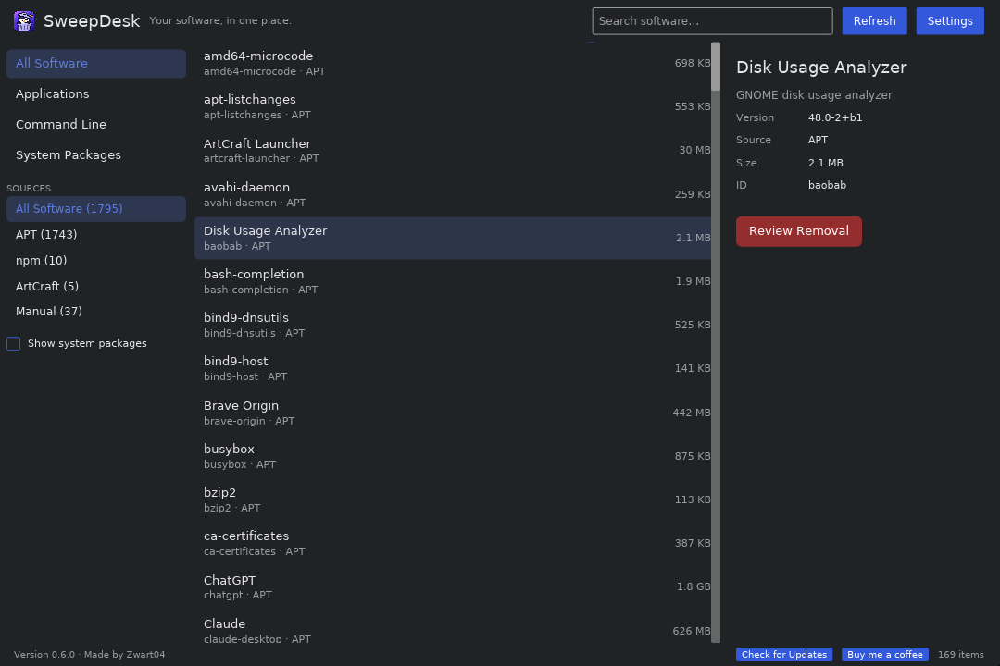
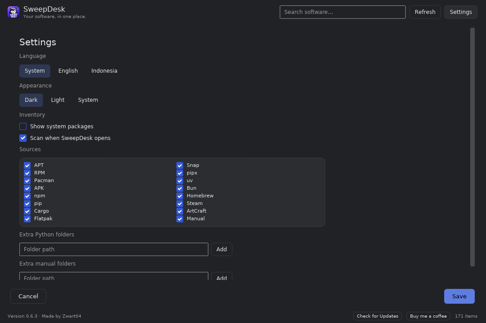

<div align="center">
  
  <h1>SweepDesk</h1>
  <p><strong>Your software, in one place.</strong><br>A small native software inventory and uninstall app for major Linux desktop families.</p>
  <p>
    <a href="https://zwart04.github.io/sweepdesk/">Website</a> ·
    <a href="https://github.com/Zwart04/sweepdesk/releases/latest">Download</a> ·
    <a href="#installation">Installation</a> ·
    <a href="#what-sweepdesk-can-clean">Cleanup coverage</a> ·
    <a href="README.id.md">Bahasa Indonesia</a>
  </p>
  <a href="https://tako.id/Zwart04"></a>
  <p>Free and open source. If SweepDesk helps you, buy me a coffee on <a href="https://tako.id/Zwart04"><strong>Tako</strong></a>.</p>
</div>



SweepDesk brings graphical apps and command-line tools into one familiar list. Search by name, package ID, or description, filter by installation source, inspect the removal plan, and choose whether to clean known user data. It is a single Rust binary that links only against glibc, so it starts fast and needs no Python, GTK, or bundled runtime.

## Compatibility

SweepDesk needs **glibc 2.28 or newer** and a graphical Linux session. `pkexec` (polkit) is used only when you remove a system package. A `.deb` is for Debian-family systems, an `.rpm` is for Fedora/openSUSE families, and the Arch package is for Pacman systems.

| Family | Download | System package support |
|---|---|---|
| Debian, Ubuntu, Linux Mint, Pop!_OS, Zorin, Kali, Raspberry Pi OS | `.deb` (amd64) | APT / dpkg |
| Fedora, Rocky, AlmaLinux, CentOS Stream | Fedora `.rpm` (x86_64) | RPM |
| openSUSE Leap / Tumbleweed | openSUSE `.rpm` (x86_64) | RPM |
| Arch Linux, EndeavourOS, Manjaro, Garuda, CachyOS | `.pkg.tar.zst` (x86_64) | Pacman |
| Other Linux desktops | Portable archive | Available non-system sources |
| Immutable/transactional desktops: Fedora Atomic, Bazzite, MicroOS, SteamOS, NixOS | Portable archive | Base-system removal stays blocked; use the distribution updater |
| Alpine Linux desktop | Build from source | APK inventory; user install only |
| Windows / macOS | — | Unsupported |

Package builds are produced for x86_64. CI checks Debian bookworm/trixie, Ubuntu 22.04/24.04/26.04, Fedora, openSUSE Tumbleweed, and Arch. Other architectures and full desktop sessions are not individually tested. See [Actions](https://github.com/Zwart04/sweepdesk/actions) for the current results.

## Installation

### Install the package for your distribution

Open [Releases](https://github.com/Zwart04/sweepdesk/releases/latest), download the matching file, then run from its folder:

```bash
# Debian / Ubuntu / Linux Mint
sudo apt install ./sweepdesk_0.6.3_amd64.deb

# Fedora / Rocky / AlmaLinux / RHEL-compatible
sudo dnf install ./sweepdesk-0.6.3-1.fedora.x86_64.rpm

# openSUSE Leap / Tumbleweed
sudo zypper install ./sweepdesk-0.6.3-1.opensuse.x86_64.rpm

# Arch / EndeavourOS / Manjaro
sudo pacman -U ./sweepdesk-0.6.3-1-x86_64.pkg.tar.zst
```

GitHub RPM/Arch artifacts are unsigned local packages; verify the published SHA-256 checksums if your policies require it. SweepDesk does not disable signature or dependency checks. Open **SweepDesk** from the application menu, or run `sweepdesk` as your normal user. Administrator authentication is requested only for system package removal.

### Run the portable archive

```bash
tar xzf sweepdesk-0.6.3-x86_64.tar.gz
cd sweepdesk-0.6.3
./sweepdesk
```

No background service, telemetry, or web server is involved. Inventories and operation logs are never sent anywhere.

### Build and install from source

```bash
git clone https://github.com/Zwart04/sweepdesk.git
cd sweepdesk
./install.sh      # builds with cargo and installs into ~/.local
```

Rust 1.80 or newer is required to build. `./install.py --uninstall` removes the per-user installation and keeps the checkout.

## What SweepDesk can clean

Select an item, choose **Review Removal**, then read the plan before confirming. Confirmation is disabled until you tick the acknowledgement box. SweepDesk always re-checks the package state or files before acting.

| Source | Inventory | Removal |
|---|---|---|
| **APT / dpkg** | `dpkg-query` database | `apt-get purge` through polkit, after a simulated plan is compared again |
| **RPM** | `rpm -qa` | `pkexec rpm -e` |
| **Pacman** | `/var/lib/pacman/local` | `pkexec pacman -Rns`, dependency removal shown first |
| **APK** | `/lib/apk/db/installed` | `pkexec apk del` |
| **Flatpak** | User and system app lists | `flatpak uninstall` for that app only |
| **npm** | Global prefixes on PATH, nvm, fnm | `npm uninstall -g --ignore-scripts` inside your home |
| **pip** | `*.dist-info` metadata read directly; system, venv, Conda, pyenv, added folders | Interpreter's `pip uninstall`, only for user-owned environments |
| **pipx / uv tools** | Their own tool lists | Their own uninstall command |
| **Cargo** | `cargo install --list` | `cargo uninstall` |
| **Snap** | `snap list` | `pkexec snap remove` without `--purge` |
| **Bun** | Global package manifest | `bun remove --global --ignore-scripts` |
| **Homebrew** | `brew info --json=v2 --installed` | `brew uninstall --formula` |
| **Steam** | Game manifests and library folders | Game folder plus manifest moved to Trash; leftover folders without a manifest are listed separately |
| **ArtCraft** | Launcher registry and user AppImage shortcuts | Files moved to Trash, registry entry rewritten |
| **Manual** | Executables in `~/.local/bin`, `~/bin`, `~/.opencode/bin`, `/usr/local/bin`, added folders; verified Horizon launcher | Only user-owned files are moved to Trash |

### Safety rules

- Package files are never deleted by hand; the owning package manager performs the removal.
- User data and unowned files are only ever **moved to Trash**, never permanently deleted.
- Paths must be user-owned, free of symlinked parents, and not inside a system directory. Broad directories such as `$HOME` are rejected.
- Steam game files are fingerprinted before the plan and compared again; removal is refused if Steam or the game is running.
- The Horizon launcher is only removed after its binary, shortcuts, and icons are proven to belong to it; saved accounts are signed out first.
- Read-only items stay listed with the reason they cannot be removed. Core packages, shared libraries, and system locations are inventory-only.
- Choice of **Also move known user data to Trash** is opt-in per removal. Known profiles for LibreOffice, OpenCode, Claude Code, Codex, curl, Flatpak apps, Steam games, and the Horizon launcher are detected.
- Shared caches and runtimes are kept. Flatpak decides related extensions at execution time; no global runtime cleanup is performed.

## Using SweepDesk

- **Sidebar:** filter by category (all software, applications, command line, system packages) and by source with live counts.
- **Search:** matches name, package ID, source, and description.
- **Details:** version, source, size, package ID, scope, plus any reason removal is unavailable.
- **Removal plan:** shows the exact commands, packages, files, and user-data folders before anything happens.



### Settings

- **Language:** English, Bahasa Indonesia, or the system locale. Changes apply immediately after **Save**.
- **Appearance:** dark, light, or system theme.
- **Inventory:** show system packages, scan when SweepDesk opens, enable or disable individual sources, and add extra Python or manual-install folders.

Preferences live in `$XDG_CONFIG_HOME/sweepdesk/preferences.json` (normally `~/.config/sweepdesk/preferences.json`) with owner-only permissions. Inventories are never written to disk.

### Updates

**Check for Updates** asks GitHub for the latest release, downloads the package that matches your distribution, verifies it against the published `SHA256SUMS`, and installs it with your distribution's package manager through `pkexec`. Nothing is downloaded or installed until you press **Install update**, and the authentication prompt is the same one your system uses for any package change. Builds without a matching package fall back to opening the releases page.

## Troubleshooting

- **No password prompt:** use a normal desktop session with a polkit authentication agent, and do not run the whole app as root.
- **A source is absent:** install or enable its manager, make sure it is reachable on `PATH`, then refresh. nvm/fnm npm, standard Cargo, Bun, uv, and Linuxbrew locations are also checked.
- **A Python package is absent:** add the environment's folder under **Settings → Extra Python folders**. dpkg packages normally appear under APT, not twice under pip.
- **A manual install is absent:** add its folder under **Settings → Extra manual folders**. Only direct executable children are scanned; source trees are not crawled.
- **An item is read-only:** read its detail panel. System ownership, PEP 668 protection, a missing `RECORD` file, or an unverifiable installation all prevent safe removal.
- **An operation fails:** keep the visible error, source, package name, and distribution. Report it in [Issues](https://github.com/Zwart04/sweepdesk/issues). Avoid posting tokens or a private inventory publicly.

## Development and tests

```bash
cargo test --manifest-path rust/Cargo.toml
cargo build --release --manifest-path rust/Cargo.toml
python3 scripts/build.py            # portable archive + .deb
python3 scripts/build.py --format rpm --rpm-flavor fedora
python3 scripts/build.py --format rpm --rpm-flavor opensuse
python3 scripts/build.py --format arch
```

Build output goes to `dist/`: a portable archive, native packages, and `SHA256SUMS`. RPM builds need `rpmbuild`; Arch builds need `makepkg` and a non-root build user. `sha256sum -c SHA256SUMS` verifies the folder.

The Rust test suite covers the language catalogue, preference migration, path safety, Steam manifest filtering, and ArtCraft/launcher inventory using temporary fixtures. CI builds and installs the real package on each listed family and runs `sweepdesk --scan` as an unprivileged user inside disposable containers. Tests never touch the host's installed applications. The README screenshot uses a labelled sample inventory, not a private software list.

## Buy me a coffee

<a href="https://tako.id/Zwart04"></a>

**[Buy me a coffee → tako.id/Zwart04](https://tako.id/Zwart04)** helps maintain compatibility, testing, and new cleanup profiles. Buying a coffee is optional; all features remain available.

Original code, application artwork, and documentation: [GNU GPL v3.0 or later](LICENSE) (`GPL-3.0-or-later`), copyright (C) 2026 Zwart04. Distributed without warranty. Redistribution of modified versions must comply with the GPL, including providing corresponding source code. Earlier releases through 0.5.1 retain their MIT permissions; see [license history](docs/LICENSE-HISTORY.md). Third-party names and artwork remain under their upstream terms. SweepDesk is independent of Debian, Ubuntu, ArtCraft, and the package managers it supports.
